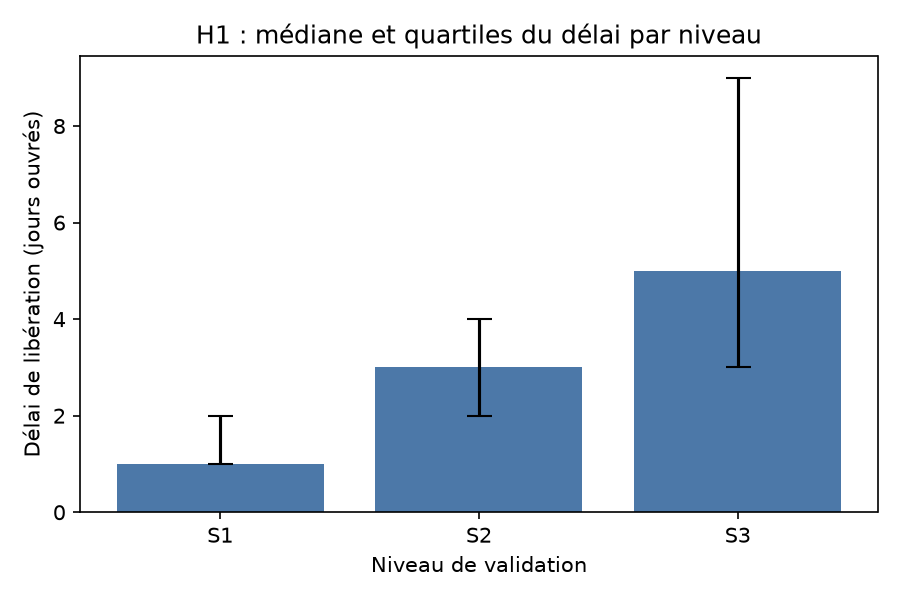
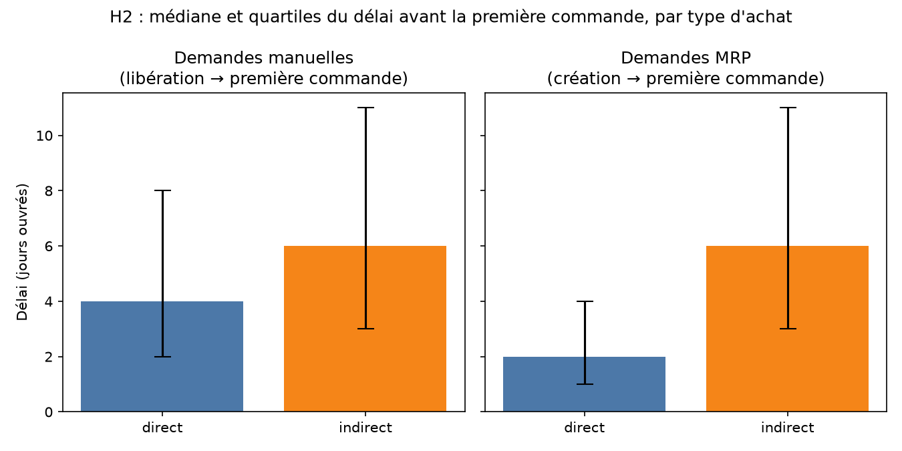
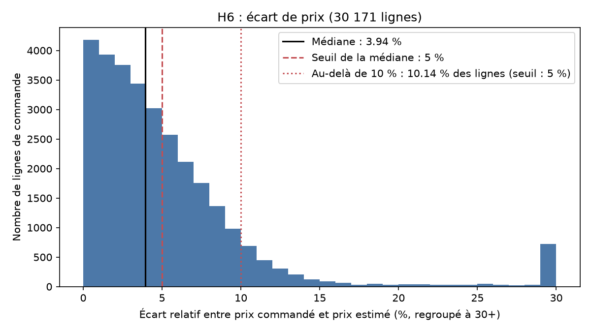
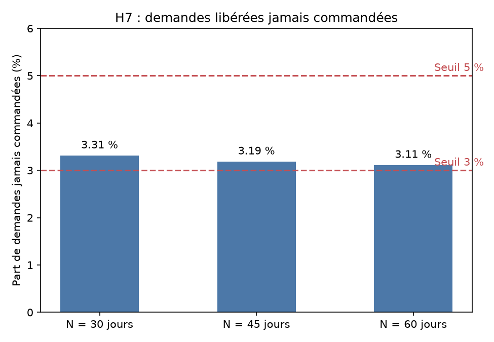
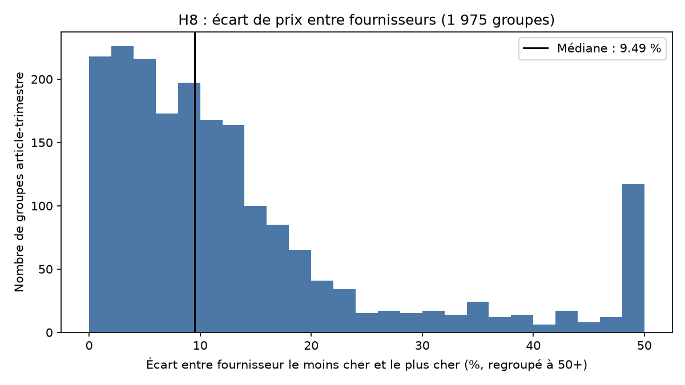

## H1. Le délai de libération augmente avec le niveau de validation

**Seuil.** Médianes croissantes de S1 à S3, avec au moins 1 jour ouvré d'écart entre deux niveaux voisins.

**Population.** Demandes manuelles, non rejetées, avec une date de libération (`dans_h1`) : 17 982.

**Résultat** (jours ouvrés, requête `20_H1.sql`).

| Niveau | Effectif | Médiane | q1 | q3 |
|---|---|---|---|---|
| S1 | 2 235 | 1 | 1 | 2 |
| S2 | 9 467 | 3 | 2 | 4 |
| S3 | 6 280 | 5 | 3 | 9 |

**Verdict.** Confirmée. Le délai de libération augmente avec le niveau de validation : l'écart entre les médianes est de 2 jours ouvrés entre S1 et S2 et de 2 jours ouvrés entre S2 et S3, soit plus que le seuil d'un jour ouvré. Plus le niveau de validation augmente, plus le délai de libération augmente.

**Lecture.** Les effectifs correspondent à ceux de l'audit 07. La conclusion porte sur les médianes : S2 et S3 se recouvrent (q3 de S2 = 4, q1 de S3 = 3) et le quart supérieur de S3 dépasse 9 jours ouvrés. La distribution détaillée de chaque niveau est traitée en phase 4 (approfondissement).

## H2. Le délai avant la première commande est plus long pour l'indirect

**Seuil.** Écart de médianes d'au moins 1 jour ouvré, l'indirect étant le plus long.

**Population.** Demandes manuelles libérées avec au moins une commande (`dans_h1` et `delai_commande` non vide) : 17 386. Les 596 demandes manuelles jamais commandées sont absentes. Le MRP, sans libération, est présenté à part (11 969 demandes, délai mesuré depuis la création).

**Résultat** (jours ouvrés, requêtes `21_H2.sql`).

| Population | Type d'achat | Effectif | Médiane | q1 | q3 |
|---|---|---|---|---|---|
| Manuelles (libération → première commande) | direct | 965 | 4 | 2 | 8 |
| Manuelles (libération → première commande) | indirect | 16 421 | 6 | 3 | 11 |
| MRP (création → première commande) | direct | 10 885 | 2 | 1 | 4 |
| MRP (création → première commande) | indirect | 1 084 | 6 | 3 | 11 |

**Verdict.** Confirmée. Chez les demandes manuelles, la médiane de l'indirect dépasse celle du direct de 2 jours ouvrés, au-dessus du seuil d'un jour. Le même sens est observé pour le MRP (écart de 4 jours).

**Lecture.** Le délai du MRP part de la création et celui des demandes manuelles de la libération : ils ne sont pas comparables directement. Le MRP direct (2 jours) reste néanmoins plus rapide que le manuel direct, même sans compter la phase d'approbation propre aux demandes manuelles. Le type d'achat et l'origine sont presque confondus (94 % des demandes manuelles sont indirectes, 91 % des demandes MRP sont directes), et le direct manuel ne repose que sur 965 demandes. Les quartiles se recouvrent chez les manuelles. Explication candidate, non testée : une pression de temps plus forte sur les achats directs, qui alimentent la production. À examiner en phase 4. Seules les demandes commandées ont un délai : les demandes jamais commandées (596 manuelles, 399 MRP) ne sont pas dans la comparaison.

## H3. Les commandes sans demande sont rares

**Seuil.** Moins de 5 % des lignes de commande n'ont pas de demande.

**Population.** Toutes les lignes de commande : 32 046.

**Résultat** (requête `22_H3.sql`).

| Lignes sans demande | Lignes au total | Part |
|---|---|---|
| 1 875 | 32 046 | 5,85 % |

**Verdict.** Rejetée. La part de lignes sans demande (5,85 %) dépasse le seuil de 5 %.

**Lecture.** Le chiffre était déjà connu depuis l'audit 04 ; le seuil avait été fixé au cadrage. Le dépassement est de 0,85 point : la conclusion est proche du seuil. La mesure porte sur les lignes de commande, comme prévu au cadrage. L'origine de ces lignes est à examiner en phase 4.

## H4. Moins de 2 % des lignes sont commandées avant la libération de leur demande

**Seuil.** Moins de 2 % des lignes, comparaison stricte (commande le jour même de la libération = pas d'infraction).

**Population.** Lignes de `commandes` dont la demande a une date de libération : 17 824.

**Résultat** (`23_H4.sql`).

| Lignes commandées avant libération | Lignes de la population | Part |
|---|---|---|
| 0 | 17 824 | 0,00 % |

**Verdict.** Confirmée : aucune ligne n'est commandée avant la libération.

**Lecture.** Contrôle de cohérence : 177 lignes sont commandées le jour même de la libération (non comptées, par la règle stricte) et 17 647 après. Le résultat est de 0 %, la contrainte semble donc respectée par construction dans ce jeu simulé.

---

## H5. Une demande rejetée n'est jamais commandée

**Seuil.** 0 cas.

**Population.** Demandes au statut `rejetee` : 1 650.

**Résultat** (`24_H5.sql`).

| Rejetées commandées | Demandes rejetées |
|---|---|
| 0 | 1 650 |

**Verdict.** Confirmée : 0 cas sur 1 650.

**Lecture.** Aucune demande rejetée n'a de ligne de commande.

---

## H6. Le prix commandé reste proche du prix estimé

**Seuil.** Écart relatif médian inférieur à 5 %, et moins de 5 % des lignes au-delà de 10 %. Les deux critères doivent être remplis.

**Population.** Lignes de commande avec demande liée et prix estimé strictement positif : 30 171. Prix commandé converti en euros (1 EUR = 1,133 USD).

**Résultat** (`25_H6.sql`).

| Critère | Résultat | Seuil | Atteint |
|---|---|---|---|
| Écart médian | 3,94 % | < 5 % | Oui |
| Part des lignes au-delà de 10 % | 10,14 % | < 5 % | Non |

**Verdict.** Rejetée : le premier critère est rempli, le second ne l'est pas (10,14 % contre 5 %).

**Lecture.** La majorité des lignes est proche du prix estimé, mais une queue de lignes s'en écarte nettement : le dernier groupe du graphique (30 % et plus) est visible. Le taux de change de 1,133 est une approximation, qui touche les lignes en USD.

---

## H7. Moins de 5 % des demandes libérées ne sont jamais commandées

**Seuil.** Moins de 5 %, testé aussi à 3 % et 10 %.

**Population.** Demandes manuelles de `dans_h1` créées il y a au moins N = 45 jours (création au plus tard le 20/09/2026), pour laisser le temps de commander : 17 633. Les commandées en partie ne comptent pas comme « jamais commandées ».

**Résultat** (`26_H7.sql`).

| N (jours) | Demandes | Jamais commandées | Part |
|---|---|---|---|
| 30 | 17 982 | 596 | 3,31 % |
| **45** | **17 633** | **562** | **3,19 %** |
| 60 | 17 212 | 536 | 3,11 % |

**Verdict.** Confirmée aux seuils de 5 % et de 10 %, non confirmée au seuil strict de 3 % (3,19 %).

**Lecture.** Le résultat est stable selon N (de 3,11 % à 3,31 %), donc le choix de 45 jours ne change pas le verdict.

---

## H8. Un même article se paie différemment selon le fournisseur

**Seuil.** Aucun seuil de conformité : constat descriptif, conduit si la variation de prix d'un article reste faible (coefficient de variation médian inférieur à 15 % ; audit 10 : 6,8 %).

**Population.** Lignes de commande avec article (`MATNR`) renseigné, prix en euros. Prix médian par article, trimestre et fournisseur, puis écart entre fournisseur le moins cher et le plus cher, pour les groupes article-trimestre ayant au moins 2 fournisseurs : 1 975 groupes.

**Résultat** (`27_H8.sql`).

| Indicateur | Valeur |
|---|---|
| Groupes article-trimestre | 1 975 |
| Écart médian | 9,49 % |
| Q1 / Q3 | 4,52 % / 16,41 % |

**Verdict.** Constat : à article et trimestre égaux, le fournisseur le plus cher facture en médiane 9,49 % de plus que le moins cher.

**Lecture.** Le critère de 15 % a été fixé après avoir vu 6,8 % : il est à lire avec cette réserve. La variation de prix d'un même article (6,8 %) est du même ordre que l'écart médian entre fournisseurs (9,49 %) : une partie de cet écart peut venir de la variation normale des prix et non d'une vraie différence entre fournisseurs. Le constat est descriptif et ne conclut pas sur la performance des fournisseurs.